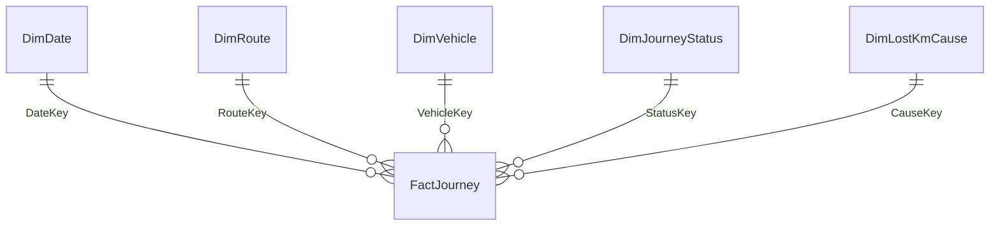

# Irish Regional Bus Network Performance – Power BI

A Power BI (Business Intelligence) project that monitors service reliability, punctuality and data quality for a regional bus network in Ireland. It includes a star-schema semantic model, DAX (Data Analysis Expressions) measures with time intelligence, dynamic Row-Level Security (RLS) for regional managers, and a paginated monthly MI (Management Information) report.

> **All data in this repository is synthetic.** It was generated by [`scripts/generate_data.py`](scripts/generate_data.py) and does not come from any transport operator, authority or real timetable. Irish place names are used only to make the scenario realistic.


---

## Business questions

1. Are we delivering the kilometres we scheduled? Where, when and why are we losing them?
2. Are buses departing on time, and which routes, regions and times of day are worst?
3. Can we trust the tracking data? How much "missing" service is really an AVL (Automatic Vehicle Location) or GPS (Global Positioning System) data gap rather than lost service?
4. Can each regional manager see only their own region, from a single report?
5. Can management get a fixed-format monthly PDF pack without rebuilding it each month?

## What's inside

| Component | Detail |
|---|---|
| Data | 299,136 scheduled journeys, 24 routes, 6 regions, 166 vehicles, 1 Jan 2024 – 31 Dec 2025 |
| Model | Star schema: `FactJourney` plus 5 dimensions; single-direction one-to-many relationships; dedicated date table |
| Power Query | Parameterised source folder, explicit typing with `en-IE` culture, derived sort and grouping columns |
| DAX | 50 measures: lost km %, punctuality %, AVL tracking rate, RAG (Red / Amber / Green) colours, previous month, same period last year, rolling 3 months, YTD (year to date), ranking, top cause, dynamic MI commentary |
| Report | 5 pages: Network Overview, Lost Kilometres, Punctuality, Data Quality (AVL), Route Detail (drill-through) |
| Security | Static roles per region, plus one **dynamic** role driven by `USERPRINCIPALNAME()` and a user-to-region mapping table |
| Paginated | Power BI Report Builder MI pack: month parameter, network summary, one page per region, conditional formatting, PDF export |

## Data model




**Grain:** one row per scheduled journey. **Key design choice:** what happened to a journey (`DimJourneyStatus`) is kept separate from why (`DimLostKmCause`). A journey that disappears from AVL tracking but is confirmed as operated from duty and vehicle records is classed as *Operated - AVL non-tracking*. It carries zero lost km, so data-quality failures are not reported as service failures. Full dictionary: [docs/02-data-model.md](docs/02-data-model.md).

## KPI definitions

| KPI (Key Performance Indicator) | Definition | Target |
|---|---|---|
| Lost Km % | Lost km ÷ scheduled km | ≤ 2.0% |
| Punctuality % | Departures between 1 min early and 5 min late ÷ tracked departures | ≥ 90% |
| AVL Tracking Rate % | Operated journeys with an AVL record ÷ operated journeys | ≥ 98% |

These targets and rules are this project's own assumptions.

## Example DAX

```dax
Punctuality % =
DIVIDE ( [On-Time Departures], [Tracked Departures] )

Lost Km % Rolling 3M =
VAR Window = DATESINPERIOD ( DimDate[Date], MAX ( DimDate[Date] ), -3, MONTH )
RETURN DIVIDE ( CALCULATE ( [Lost Km], Window ), CALCULATE ( [Scheduled Km], Window ) )

Breakdown Lost Km per 1,000 Km =
DIVIDE ( CALCULATE ( [Lost Km], DimLostKmCause[CauseKey] = 2 ), [Scheduled Km] ) * 1000
```
All measures: [powerbi/measures.dax](powerbi/measures.dax).

## Row-Level Security

```dax
-- Role: Regional Manager (dynamic), table DimRoute
[Region] IN CALCULATETABLE (
    VALUES ( SecurityUserRegion[Region] ),
    SecurityUserRegion[UserEmail] = LOWER ( USERPRINCIPALNAME () )
)
```
One role serves every manager. Adding a manager is a row in a mapping table, not a model change. A user who isn't mapped sees nothing rather than everything. Tested with *View as > Other user* for single-region, multi-region, all-region and unmapped users. See [docs/03-row-level-security.md](docs/03-row-level-security.md).


## Paginated MI report

A month-parameterised A4 PDF pack: a network summary page, then one page per region with route tables, conditional formatting against target, lost km by cause and an auto-generated commentary line. See [docs/04-paginated-mi-report.md](docs/04-paginated-mi-report.md).


## Key findings (from the synthetic data)

- **Lost km % was 2.23% over the two years, above the 2.0% target.** Most months met target. The overshoot is concentrated in **October 2024 – March 2025**, when lost km from driver availability more than doubled.
- **January 2025 alone lost 6.58% of scheduled km.** Almost all of it came from one severe-weather day, which the rolling 3-month measure smooths out.
- **Internal causes (vehicle defects and driver availability) account for 57% of lost km.** These are the causes the operator can act on.
- **Breakdown losses rise with vehicle age:** 5.6 km per 1,000 scheduled km for vehicles 0–3 years old, against about 7.7 for vehicles 8 years or older.
- **East region punctuality is 82.7%**, against 91–93% elsewhere. It is driven by commuter corridors at peak times. Its three Dublin-bound routes are also the top three routes for lost km.
- **North-West AVL tracking improved from 95.7% to 98.8%** after an equipment upgrade in June 2025, which brought it up to the network target.

## Repository structure

```
├── data/                     Star-schema CSVs (synthetic)
│   └── paginated/            Monthly aggregates for the offline paginated report
├── docs/
│   ├── 01-build-guide.md     Step-by-step Power BI Desktop build
│   ├── 02-data-model.md      Schema, data dictionary, business rules
│   ├── 03-row-level-security.md
│   ├── 04-paginated-mi-report.md
│   └── 05-expected-results.md  Numbers to validate the build against
├── powerbi/
│   ├── measures.dax          All DAX measures
│   ├── power-query.m         Power Query (M language) for every table
│   ├── theme.json            Report theme
│   └── *.pbix / *.rdl        Power BI report and paginated report
├── preview/                  Web preview dashboard (HTML) and its aggregated CSVs
├── scripts/
│   ├── generate_data.py      Synthetic data generator (seeded, reproducible)
│   └── build_outputs.py      Expected results + paginated aggregates
└── images/                   Screenshots
```

