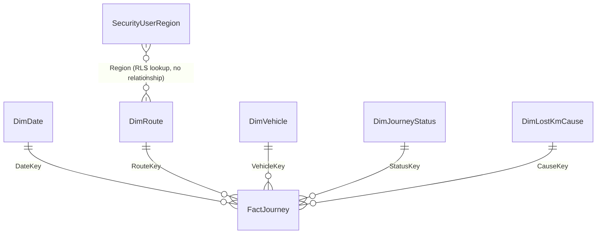

# Data model and data dictionary

## Star schema

One fact table at the grain of **one row per scheduled journey** (a single trip on a route, in one direction, at one departure time, on one day), surrounded by five dimensions. A security table sits outside the model and is used only by Row-Level Security.

### Relationships to create (Model view)

| From (one side) | To (many side) | Cardinality | Cross-filter |
|---|---|---|---|
| DimDate[DateKey] | FactJourney[DateKey] | 1 : * | Single |
| DimRoute[RouteKey] | FactJourney[RouteKey] | 1 : * | Single |
| DimVehicle[VehicleKey] | FactJourney[VehicleKey] | 1 : * | Single |
| DimJourneyStatus[StatusKey] | FactJourney[StatusKey] | 1 : * | Single |
| DimLostKmCause[CauseKey] | FactJourney[CauseKey] | 1 : * | Single |

All filters flow one way, from dimension to fact. No bi-directional relationships are needed. Bi-directional filters would slow the model and make the RLS harder to reason about.

### Why this shape

- **Region sits on DimRoute, not on its own table.** Each route belongs to one region and one depot, so they are attributes of the route. This keeps it a pure star. The RLS filter on `DimRoute[Region]` then reaches every fact row through a single relationship.
- **Status and cause are separate dimensions.** *What happened* (operated, partial, bypassed, not operated, non-tracking) is a different question from *why* (driver, vehicle, traffic, weather, data). Splitting them lets you ask "how many partial journeys were caused by vehicle defects?" without awkward combined codes.
- **AVL (Automatic Vehicle Location) non-tracking is its own status.** A journey that didn't appear on GPS is not automatically lost service. If duty and vehicle records show it ran, it is classified as *Operated - AVL non-tracking* with cause *AVL / GPS data issue*, and it carries **zero** lost km. That separates real service failures from data-quality failures.
- **Integer surrogate keys** (`DateKey` as yyyymmdd, `RouteKey` …) keep the fact table narrow and relationships fast.

---

## Tables

### FactJourney — 299,136 rows (1 Jan 2024 – 31 Dec 2025)

| Column | Type | Meaning |
|---|---|---|
| JourneyID | Whole number | Unique journey identifier |
| DateKey | Whole number | Service date, yyyymmdd → DimDate |
| RouteKey | Whole number | → DimRoute |
| VehicleKey | Whole number | Vehicle allocated → DimVehicle |
| ScheduledDeparture | Time | Timetabled departure (hh:mm) |
| DepartureHour | Whole number | Hour of scheduled departure, 0–23 |
| TimeBand | Text | Early, AM Peak (07–09), Interpeak, PM Peak (16–18), Evening (19+) |
| TimeBandOrder | Whole number | Added in Power Query, used to sort TimeBand |
| Direction | Text | Outbound / Inbound |
| StatusKey | Whole number | → DimJourneyStatus |
| CauseKey | Whole number | → DimLostKmCause (0 = no issue) |
| ScheduledKm | Decimal | Timetabled distance for the journey |
| OperatedKm | Decimal | Distance actually operated |
| LostKm | Decimal | ScheduledKm − OperatedKm for genuine lost service; 0 otherwise |
| DepartureDelayMins | Whole number (nullable) | Actual minus scheduled departure, from AVL. Negative = early. Blank when not operated or not tracked |
| IsTracked | True/False | Whether AVL recorded the journey |
| Passengers | Whole number | Boardings on the journey |

### DimDate — 731 rows
`DateKey, Date, Year, Quarter, MonthNo, MonthName, YearMonth, MonthStart, WeekdayNo, WeekdayName, IsBankHoliday, DayType`
Irish public holidays for 2024–2025 are flagged. `DayType` (Weekday / Saturday / Sunday / Bank Holiday) drives the reduced weekend timetable. **Sort** `MonthName` by `MonthNo` and `WeekdayName` by `WeekdayNo`. **Mark as date table** on `Date`.

### DimRoute — 24 rows
`RouteKey, RouteCode, RouteName, ServiceType, Depot, Region, KmPerTrip, WeekdayTripsPerDirection` (+ `RouteLabel` added in Power Query)
Six regions: South, West, Mid-West, South-East, North-West, East. Four service types: City, Town, Commuter, Regional.

### DimVehicle — 166 rows
`VehicleKey, FleetNumber, VehicleType, FuelType, YearIntroduced, HomeDepot, AllocatedService` (+ `AgeBand` added in Power Query)

### DimJourneyStatus — 5 rows

| StatusKey | JourneyStatus | IsOperated | IsLostService |
|---|---|---|---|
| 1 | Operated in full | True | False |
| 2 | Partially operated | True | True |
| 3 | Stops bypassed | True | True |
| 4 | Not operated | False | True |
| 5 | Operated - AVL non-tracking | True | False |

### DimLostKmCause — 8 rows

| CauseKey | Cause | CauseCategory | CountsAsLostKm |
|---|---|---|---|
| 0 | No issue | None | False |
| 1 | Driver availability | Internal | True |
| 2 | Vehicle defect / breakdown | Internal | True |
| 3 | Traffic congestion | External | True |
| 4 | Road works / diversion | External | True |
| 5 | Severe weather | External | True |
| 6 | Road traffic incident | External | True |
| 7 | AVL / GPS data issue | Data quality | False |

### SecurityUserRegion — 14 rows
`UserEmail, Region`. Maps users to regions for dynamic RLS. All emails are fictional `@example.com` addresses.

---

## Business rules (KPI definitions)

| KPI (Key Performance Indicator) | Definition | Target |
|---|---|---|
| Lost Km % | Lost km ÷ scheduled km | ≤ 2.0% |
| Punctuality % | Departures between 1 min early and 5 min late ÷ tracked departures | ≥ 90% |
| AVL Tracking Rate % | Operated journeys with an AVL record ÷ operated journeys | ≥ 98% |
| Km Delivered % | Operated km ÷ scheduled km | — |

These rules and targets are this project's own assumptions, chosen to make the analysis realistic. They are not any operator's or regulator's official definitions.

## Patterns built into the synthetic data (things the report should reveal)

1. **Driver availability pressure, Oct 2024 – Mar 2025**: cancellations rise, worst in East and South.
2. **Severe weather on 24 Jan 2025**: most services cancelled for the day. January 2025 lost km % spikes to about 6.6%.
3. **North-West AVL upgrade, June 2025**: tracking rate jumps from about 95–96% to about 99%.
4. **East region punctuality** is lowest, driven by congestion on commuter corridors at peak times.
5. **Older vehicles** account for more breakdown-related lost km.
6. **Winter months** have more lost km and slightly worse punctuality than summer.
